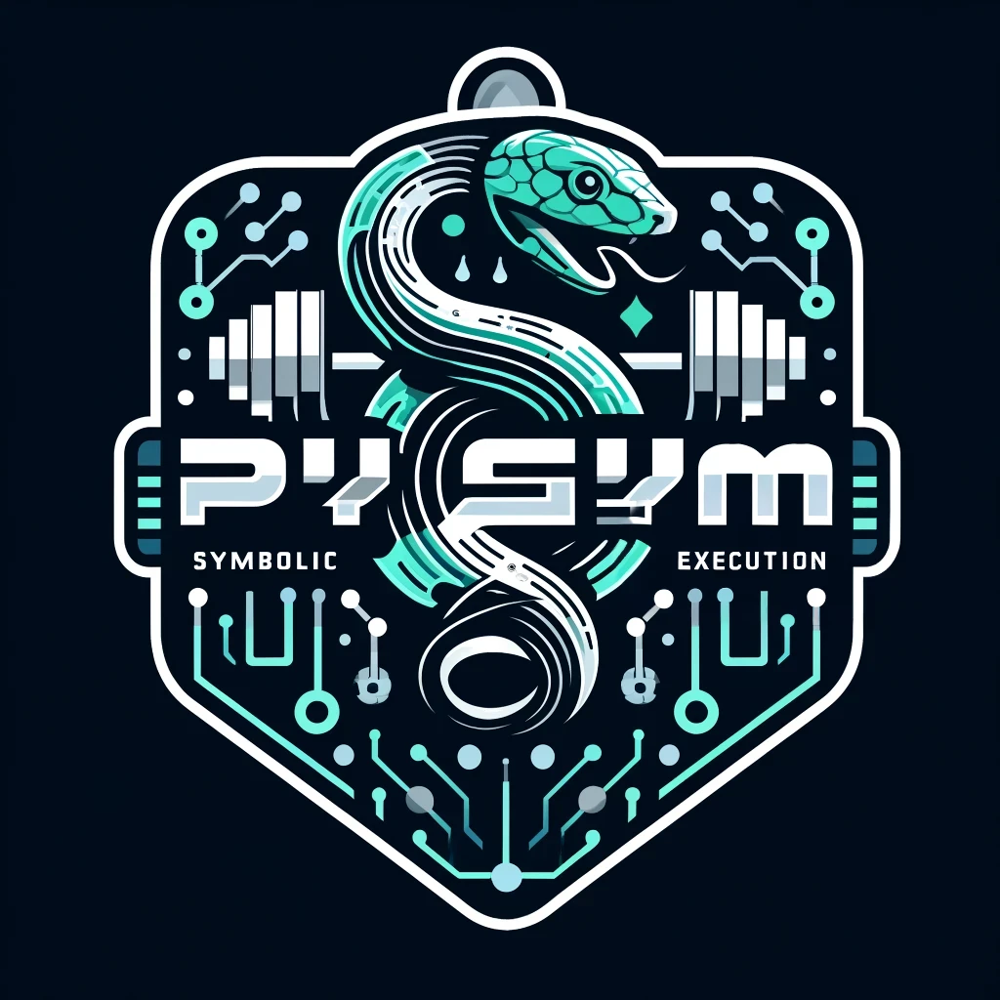

<p align="center">
  
</p>

# PySymGym

[](https://github.com/PySymGym/PySymGym/actions/workflows/python_linting.yaml)
[](https://github.com/PySymGym/PySymGym/actions/workflows/build_and_run.yaml)
[](https://github.com/PySymGym/PySymGym/actions/workflows/python_tests.yaml)

Python infrastructure to train path selectors for symbolic execution engines.

## Install

This repository contains submodules, so use the following command to get sources locally.

```sh
git clone https://github.com/PySymGym/PySymGym.git
git submodule update --init --recursive
```

Setup environment:

```bash
pipx install poetry
poetry install
```

For toolchain prerequisites (Python 3.11–3.13, .NET SDK, JDK), GPU installation,
and submodule repair, see the [setup guide](https://pysymgym.github.io/PySymGym/setup.html).

## Documentation

The documentation is the map for navigating the project. Start at the
[docs home](https://pysymgym.github.io/PySymGym/), or jump directly to a page:

- [Architecture](https://pysymgym.github.io/PySymGym/architecture.html)
- [Usage](https://pysymgym.github.io/PySymGym/usage.html)
- [Integration](https://pysymgym.github.io/PySymGym/integration.html)
- [Dataset](https://pysymgym.github.io/PySymGym/dataset.html)
- [Results](https://pysymgym.github.io/PySymGym/results.html)
- [Developer guide](https://pysymgym.github.io/PySymGym/developer.html)
- [Testing](https://pysymgym.github.io/PySymGym/testing.html)
- [API reference](https://pysymgym.github.io/PySymGym/reference/)
