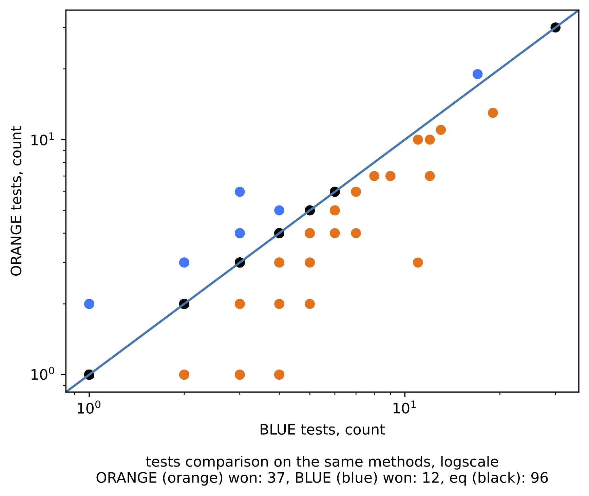

# Usage

Prerequisites: cd into tools' directory

## `runstrat` tool

The tool is the `runstrat` package; run it with `python3 -m runstrat` from
this directory.

Docs:

```bash
usage: runstrat [-h] -s STRATEGY [-mp MODEL_PATH] -t TIMEOUT [-ps PYSYMGYM_PATH] [-as dlls-path launch-info-path]

options:
  -h, --help            show this help message and exit
  -s STRATEGY, --strategy STRATEGY
                        V# searcher strategy
  -mp MODEL_PATH, --model-path MODEL_PATH
                        Absolute path to AI model if AI strategy is selected
  -t TIMEOUT, --timeout TIMEOUT
                        V# runner timeout
  -ps PYSYMGYM_PATH, --pysymgym-path PYSYMGYM_PATH
                        Absolute path to PySymGym
  -as dlls-path launch-info-path, --assembly-infos dlls-path launch-info-path
                        Provide tuples: dir with dlls/assembly info file
```

To start benchmark, run

```bash
python3 -m runstrat \
    --strategy AI \
    --model-path <..>/model.onnx \
    --timeout 120 \
    --pysymgym-path <abs-path-to-PySymGym> \
    --assembly-infos <abs-path-to-PySymGym>/maps/DotNet/Maps/Root/bin/Release/net7.0 <abs-path-to-prebuilt>/assembled.csv \
    --assembly-infos <abs-path-to-prebuilt>/cosmos/publish prebuilt/cosmos_os.csv \
    --assembly-infos <abs-path-to-prebuilt>/powershell-osx-arm64 prebuilt/powershell.csv
```

Or shortened version:

```bash
python3 -m runstrat \
    -s AI \
    -t 120 \
    -ps <abs-path-to-PySymGym> \
    -as <abs-path-to-PySymGym>/maps/DotNet/Maps/Root/bin/Release/net7.0 <path-to-prebuilt>/assembled.csv \
    -as <path-to-prebuilt>/cosmos/publish prebuilt/cosmos_os.csv \
    -as <path-to-prebuilt>/powershell-osx-arm64 prebuilt/powershell.csv
```

## `compstrat` tool

The tool is the `compstrat` package; run it with `python3 -m compstrat` from
this directory.

Docs:
```bash
usage: compstrat [-h] -s1 STRAT1 -r1 RUNS1 [RUNS1 ...] -s2 STRAT2 -r2 RUNS2 [RUNS2 ...] -cp CONFIGS_PATH [--savedir SAVEDIR]

options:
  -h, --help            show this help message and exit
  -s1 STRAT1, --strat1 STRAT1
                        Name of the first strategy
  -r1 RUNS1 [RUNS1 ...], --runs1 RUNS1 [RUNS1 ...]
                        Paths to the first strategy runs results
  -s2 STRAT2, --strat2 STRAT2
                        Name of the second strategy
  -r2 RUNS2 [RUNS2 ...], --runs2 RUNS2 [RUNS2 ...]
                        Paths to the second strategy runs results
  -cp CONFIGS_PATH, --configs-path CONFIGS_PATH
                        Path to the compare configurations
  --savedir SAVEDIR     Path for saving the comparison results
```
To compare two results run

```bash
python3 -m compstrat \
    -s1 ALHPA -r1 mock_runs/strat_alpha.csv \
    -s2 BETA -r2 mock_runs/strat_beta.csv \
    -cp resources/compare_confs.yaml
```

Output example

## Dataset Management
Tools for managing training episodes in dataset.json. `generate_episodes` expands the dataset by creating episodes with different starting points for diverse training data, analyzing existing episodes and adding new ones at regular intervals with both BFS and DFS variants while preserving all existing episodes. `clean` removes useless episodes by analyzing training logs for "immediate GameOver" entries — these occur when too many preliminary BFS/DFS steps complete the task during the StepsToStart phase before the neural network is needed. Since the neural network was simply not used in these episodes, they are worthless for training and are removed.


## `generate_episodes` tool


This tool expands the dataset by creating new episodes for each method. The step sizes are chosen based on the method's StepsToPlay value. For each step, both BFS and DFS variants are added if missing.

Docs:
```bash
usage: generate_episodes.py [-h] [-d DATASET]

options:
  -h, --help            show this help message and exit
  -d DATASET, --dataset DATASET
                        Path to the dataset JSON file 
```
Run:
```bash
Use custom dataset path:
PYTHONPATH=../../AIAgent python3 generate_episodes.py -d <path-to-dataset>

Use default dataset path (../../maps/DotNet/Maps/dataset.json):
PYTHONPATH=../../AIAgent python3 generate_episodes.py
```
## `clean` tool

This tool removes episodes from the dataset that have "immediate GameOver" entries in the log file.

Docs:
```bash
usage: clean.py [-h] [-d DATASET] [-l LOG]

options:
  -h, --help            show this help message and exit
  -d DATASET, --dataset DATASET
                        Path to the dataset JSON file
  -l LOG, --log LOG 
                Path to the log file
Use default paths (../../maps/DotNet/Maps/dataset.json and ../../AIAgent/ml_app.log):
PYTHONPATH=../../AIAgent python3 clean.py

Use custom log file:
PYTHONPATH=../../AIAgent python3 clean.py -l ../../AIAgent/<name>.log

Use custom dataset and log paths:
PYTHONPATH=../../AIAgent python3 clean.py -d <path-to-dataset> -l <path-to-log>
```

## Dependencies

The tools are standalone except for one explicit, one-way dependency on the
agent package:

- `runstrat`, `compstrat`, `util` — standalone: no AIAgent imports.
- `dataset_tools` (`clean.py`, `generate_episodes.py`) — import
  `common.game.GameMap` from AIAgent: the dataset schema is owned by the
  agent package (`AIAgent/common/game.py`), and the tools operate on its
  dataset files. The dependency direction is tools → AIAgent, one-way.

Running the dataset tools from the CLI therefore requires `AIAgent` on
`PYTHONPATH` (the commands in [docs/dataset.rst](../docs/dataset.rst) show
it); the test suites get it from the root `conftest.py` instead. The scripts
deliberately do not add `AIAgent` to `sys.path` at import time — that
coupling was removed in #559 and is pinned by
`tests/test_cwd_independence.py::test_dataset_tool_import_is_side_effect_free`.

Design decisions (recorded for #589):

- **No thin shared module.** `GameMap` is the core of AIAgent's domain model
  (alongside `GameState`, `GameMap2SVM` and `SVMInfo` in
  `AIAgent/common/game.py`); extracting it would fragment that model for an
  edge that is light (dataclasses_json + pydantic only, no torch) and
  one-way.
- **No import-boundary guard for the edge.** The AST guard in
  `tests/test_import_boundaries.py` protects the shared layer
  (`AIAgent/common`) from heavy dependencies — a different concern. Freezing
  "tools must not import `ml.*`" would codify an accidental property
  (runstrat/compstrat happen to import nothing from AIAgent) without
  demonstrated need.
